# Storehouse

Storage for Valheim that holds a lot and shows what's inside. There's a store for each kind of stuff: logs in a timber crib, ore in a bin, arrows in barrels, hides on stretching frames, armor on carved mannequins. Each store takes only its own kind of item and fills up with the real items as you put things in. Full looks full.

**Install:** [Storehouse on Thunderstore](https://thunderstore.io/c/valheim/p/DJ_Lifecoach/Storehouse/) · **Source:** [GitHub](https://github.com/joostliebregts/valheim-storehouse) (MIT) · **Roadmap:** [what is coming next](https://github.com/joostliebregts/valheim-storehouse/blob/main/ROADMAP.md)

*Unofficial mod: not affiliated with or endorsed by Iron Gate or Coffee Stain.*

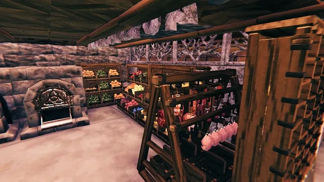

*The Produce Crates in a kitchen corner. Every crate holds one kind of crop, and you see at a glance how much is in it.*

## Why I made this

I wanted storage that actually fits the game, and that shows you what's in it and how full it is. I love giving your brain more ways to understand something than reading text or numbers. My mod [Oof](https://thunderstore.io/c/valheim/p/DJ_Lifecoach/Oof/) does that for the weight you carry; Storehouse does it for everything you store. You look at your base and you see your stock.

I'm a designer. I studied industrial design, worked with CAD, and I like making things. AI unlocks a lot of that for me: Storehouse is the fourth Valheim mod I made in the last two months. Each one got a lot of time and care. It starts with playing the game and noticing what I'd love to have in it, and then I get caught up in the details.

This one started as an experiment. I wanted to see how far today's AI models (Claude Opus 5.5 and Sol 6.1) can go with 3D models for a game, and I was thoroughly impressed. So I went with it, and before I knew it I had a whole storage system: a fitting store for almost everything you can carry. I didn't model any of it by hand. I directed, the AI built. It took three or four days of focused work, and without AI this mod wouldn't exist.

I quite like it, and that's why I'm sharing it. You can build amazing bases with it, organized by theme, with storage that fits what goes in it. I'm curious how you use it and what you think of it.

## What it does

- **You see what's in it.** The items lie in the store as themselves: heaps of coal, bars on a rack, meads on a shelf, a full set of armor on a mannequin. As you add more, the heaps grow and the shelves fill.
- **One kind of stuff per store.** You know at a glance where the hides go, or the bones, or the tar. The store refuses what doesn't belong, and nothing lies mixed.
- **Big, and based on real things.** Most stores hold more than a black metal chest. Most items show at their real size; some are a bit smaller so they fit, and some are there just so you can see them.
- **The armor stands are chests.** No more putting gear on a stand one item at a time with the hotbar keys. Open it, take your set, go.
- **A little work to build, not a grind.** No fine wood, because you always run short of it. Most stores use **Boards**, an item this mod adds, which you make from normal wood. Add nails and the materials that make sense for that piece.

## An experiment, in development

Storehouse is a hobby project, made in collaboration with AI (yes, vibe-coded). It isn't perfect, and that's part of the experiment. The heaps in several stores are settled by a real physics simulation ahead of time, so they cost nothing while you play. Other stores are simpler for now, and some still look a bit rough. I keep working on them.

It isn't balanced the way Valheim is, on purpose: the stores hold a lot and cost less than a black metal chest. It's made for one thing: a base that looks great, with storage that fits.

When I update the mod, I make sure you keep your items. Still, **back up your world (or your server) before you install it, and before every update.**

## Tell me what you think

On the [GitHub page](https://github.com/joostliebregts/valheim-storehouse), open an issue for anything: a store that looks off, an item with no store or in the wrong one, a build cost that feels unfair, an idea for a new store. I'm not a professional developer, so I'm learning how this works along the way.

In the meantime, you can change a lot yourself: the **Accepts** setting decides what goes in a store, and the **Recipe** setting what it costs.

## The stores

Build them with the hammer, on their own **Storage** tab, near a workbench. Every store takes only its own kind of item; the full list per store is at the bottom of this page, under **Where does everything go?**

### Wood, ore and stone

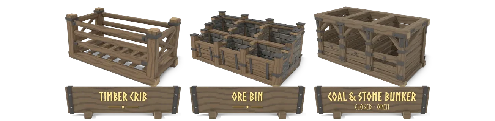

- **Timber Crib**: A growing log pile.
- **Ore Bin**: Ore and scrap, a bay per kind.
- **Coal & Stone Bunker**: Loose heaps in three bays. Stacks. The **Open Coal & Stone Bunker** is the same without a load-bearing top.

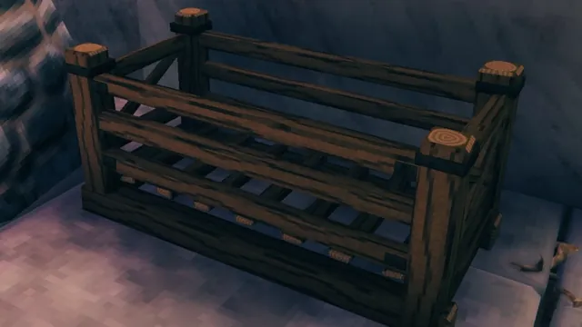

*Time-lapse: a Timber Crib fills up with wood. The more you store, the higher the log pile.*

### Metal

- **Metal Rack**: Tall, tall half, low and low half. All stack: two halves side by side make a whole rack, two lows stacked make a tall one.
- **Metal Pallet**: Bars in stacks on a pallet. Stacks.

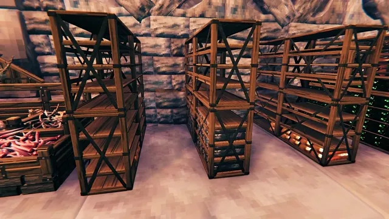

*Metal Racks and a Metal Pallet along a wall, from empty to full: copper, tin, iron, silver and other bars, stacked per metal.*

### Kitchen

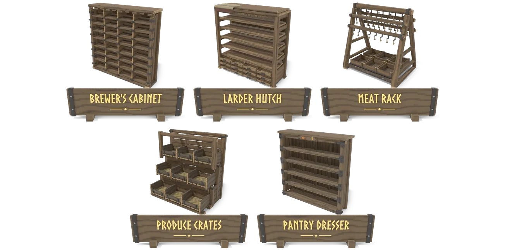

- **Brewer's Cabinet**: Meads and potions. Stacks.
- **Larder Hutch**: Cooked meals. Stacks.
- **Meat Rack**: Meat and fish, raw or cooked.
- **Produce Crates**: A crate per kind.
- **Pantry Dresser**: Flour, spices and other cooking ingredients.

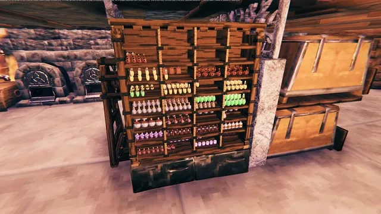

*The Brewer's Cabinet: meads and potions, each kind in its own compartments.*

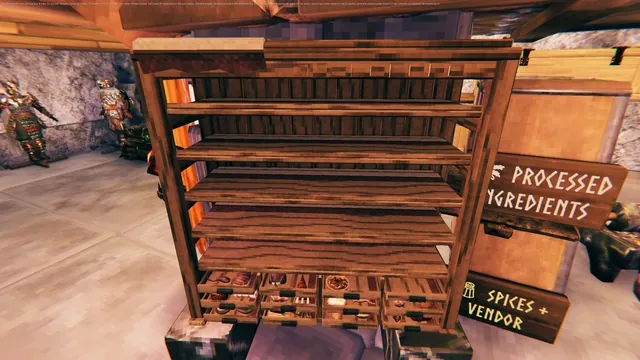

*Time-lapse: the Larder Hutch fills up with meals, shelf by shelf.*

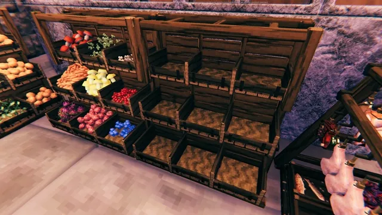

*Time-lapse: the Produce Crates fill up with crops, berries and mushrooms, each kind in its own crate.*

### Crafting goods

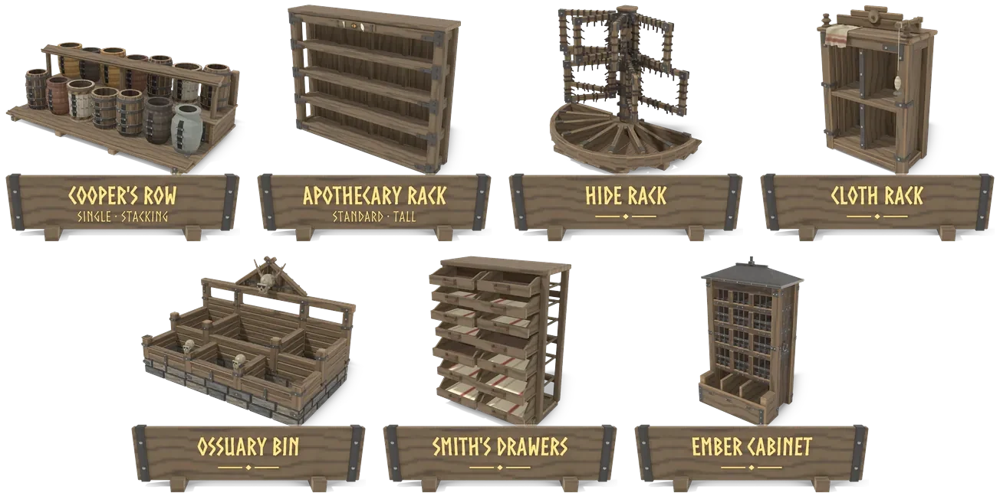

- **Cooper's Row**: A vessel per kind. The **Stacking Cooper's Row** puts the same vessels under a plank deck that something else can stand on.
- **Apothecary Rack**: Also the **Tall Apothecary Rack**. Each vessel suits what it holds: hooks, glass jars, clay crocks or baskets.
- **Hide Rack**: Stretched on frames and folded below.
- **Cloth Rack**: Cloth and thread on bolts and spools.
- **Ossuary Bin**: Bones, skulls and antlers in settled heaps.
- **Smith's Drawers**: The smith's odds and ends, drawer by drawer.
- **Ember Cabinet**: Wisps, cores, embers, orbs and the elemental stones.

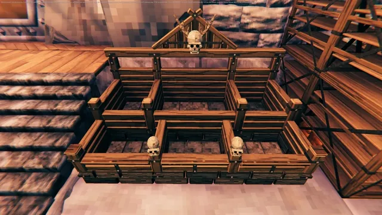

*Time-lapse: the Ossuary Bin fills up with bones, skulls and antlers. The heaps were settled by a physics simulation, so they lie the way bones would.*

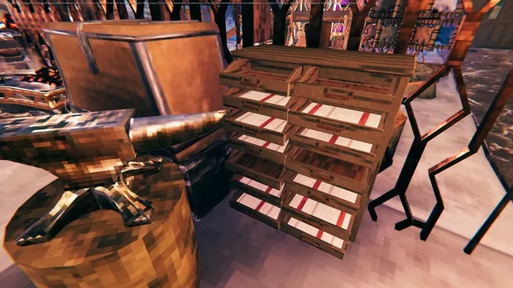

*Time-lapse: Smith's Drawers fill up with nails, chain, barrel rings, springs and other smithing parts, drawer by drawer.*

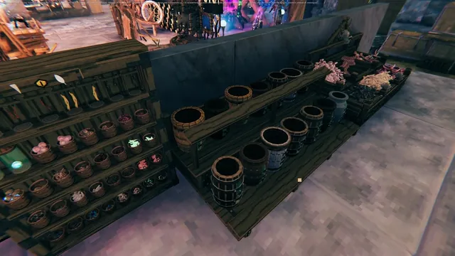

*Time-lapse: Cooper's Row fills up with tar, resin, sap, guck and the other goopy stuff monsters drop, one vessel per kind.*

### Ammunition

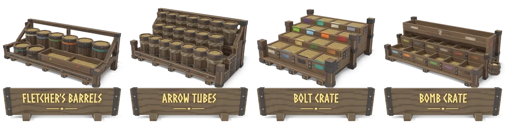

- **Fletcher's Barrels**: Arrows, bolts and bombs.
- **Arrow Tubes**: A tube per kind.
- **Bolt Crate**: Crossbow bolts.
- **Bomb Crate**: A tray per kind.

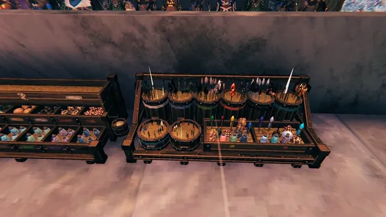

*Fletcher's Barrels and the Bolt Crate: every kind of arrow, bolt and bomb in its own place.*

### Weapons

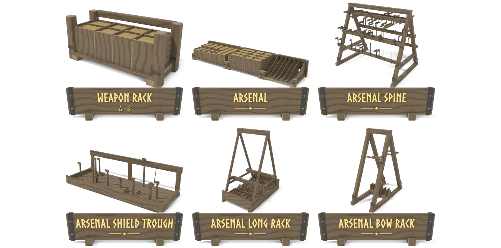

- **Weapon Rack A and B**: Eight one-handed weapons each, two builds of the same idea. Put several side by side.
- **Arsenal**: Weapons, bows and shields, the best shield on show.
- **Arsenal Spine**: An arsenal you put together yourself: shield troughs snap to its sides, the long rack and the bow rack to its ends.
- **Arsenal Shield Trough**
- **Arsenal Long Rack**
- **Arsenal Bow Rack**

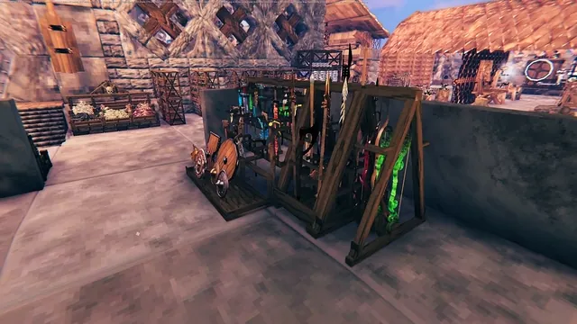

*An Arsenal: one-handed and long weapons in racks, bows, and shields on show at the front.*

### Armor

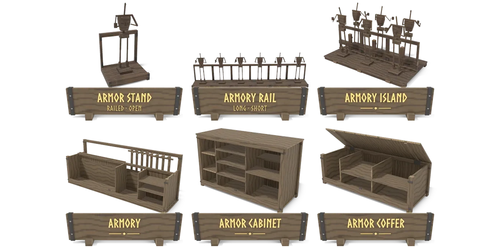

- **Armor Stand**: A carved wooden mannequin wearing a full set with its cape, weapon and shield. The **open** one has no back rail and snaps to other stands and the rails.
- **Armory Rail**: A row of the same mannequins, ready to grab. Also the **Short Armory Rail**.
- **Armory Island**: Mannequins on two sides.
- **Armory**: Armor, weapons and shields together, reachable from both aisles.
- **Armor Cabinet**: Helmets in cubbies, the rest folded on piles.
- **Armor Coffer**: Helmets in trays, the rest folded on piles.

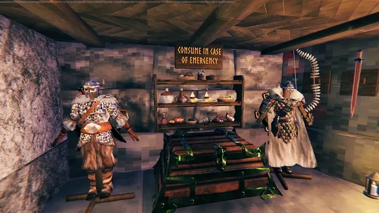

*The emergency Shelf between two Armor Stands: the gear you grab on your way back to your body after you die.*

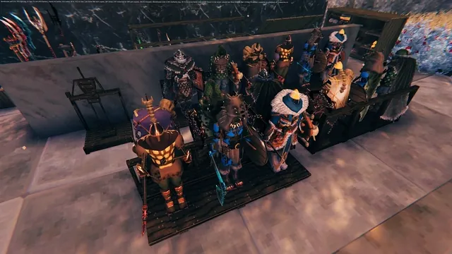

*The armories from above: Armory Rails and an Armory Island, each mannequin wearing its set. They work like chests, not like the game's own armor stands.*

### Trophies, valuables and shelves

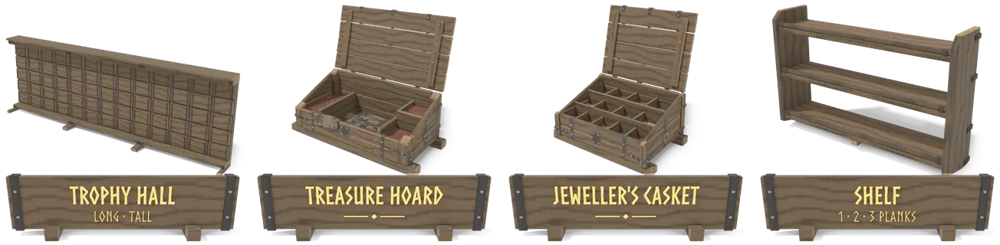

- **Trophy Hall**: Also the **Tall Trophy Hall**: a free-standing wall with a trophy on each board, the bosses' too.
- **Treasure Hoard**: Coins in the well, gold in the trays.
- **Jeweller's Casket**: Gems and jewellery, sorted finer.
- **Shelf**: 1, 2 or 3 planks, on a wall: for what you grab in a hurry, like portal materials next to the portal. Each stack shows as one item on the planks; the rest stays inside.

## Building them

Most stores are built from **Boards**, a new item made at the workbench: 1 wood makes 2 boards, or 5 wood make 10 in one go. Add some nails, iron, wood, stone or leather depending on the store; the hammer shows the exact cost.

Big outdoor stores stand on level ground or a floor. Only stores with a flat, sturdy top take another on top: the Coal & Stone Bunker, the metal racks and pallet, the Brewer's Cabinet, the Larder Hutch and the Stacking Cooper's Row. The Shelf hangs on a wall.

## How they behave

- **Each store takes only its own kind of item.** Anything else stays where it was, with a short message, whether you drag it, ctrl-click it, use Place stacks or a quick-stack mod. Hovering over a store shows what it takes. Items already inside always stay, even if the list changes later.
- **Bays fill one kind at a time.** The bunkers, the Ore Bin and the Jeweller's Casket hold as many kinds as they have bays, and refuse a new kind once every bay is taken. Build another one.
- **What has no place to show stays in the chest.** It's stored, just not drawn, and the hover tells you how many kinds that is.

## Settings

BepInEx config, synced from the server and changeable by admins only. Each store has:
- **Rows**: slots in rows of 8. The chest window scrolls.
- **Recipe** and **Crafting station**.
- **Accepts**: extra item names the filter lets in, so items from other mods can find their store.

Settings that change only how things look on your own screen: **Item size** (makes the items inside a store bigger), **Model** (an older model for a few stores), and a Performance section (how far away contents are drawn, and how detailed).

## Performance

I tested it with a lot of weapons and stores in one base. It costs some performance, but in my game the drop was small. Try it for yourself. If you need more frame rate, these settings help (Performance section):
- **Contents distance**: how far away the items in a store are drawn.
- **Far contents beyond**: from this distance, stores draw the game's lighter item models.
- **Max triangles per stack**: fewer copies of heavy items, such as feast platters and big trophies.

## Works with

- **LumberCamp / MiningCamp**: link a crib or bin with "Add nearest chest". Workers only put in what it takes.
- **MultiUserChest**: works. The filter runs first.
- **AzuCraftyBoxes**: crafting takes from the stores like from any chest.
- **ValheimArmory**: its arrows and bolts go to the ammunition stores, by type.

## Important for servers

This mod adds building pieces, so **the server and every player need it**, on the same minor version. **If Storehouse is ever removed, or fails to load while a world loads, Valheim deletes every placed Storehouse piece and everything inside it.** Decide before adding it to a shared world, and check that the BepInEx log shows Storehouse loaded before anyone joins after an update.

Lowering a store's **Rows** hides the items in the removed rows until the rows come back, so empty them first.

## Known limits

- The Ossuary Bin looks right when full of one kind; with a mix of bones it still looks thin.

## Where does everything go?

Every store with what it takes by default, by in-game name. Server admins can change this per store in the config (**Accepts**). Open a category.

<b>Wood, ore and stone</b>

<table>
<tr><td><b>Timber Crib</b></td><td><code>Ancient Bark</code> <code>Ashwood</code> <code>Corewood</code> <code>Finewood</code> <code>Frozen Branch</code> <code>Root</code> <code>Timberwood</code> <code>Wood</code> <code>Writhan Roots</code> <code>Yggdrasil Wood</code></td></tr>
<tr><td><b>Ore Bin</b></td><td><code>Black Metal Scrap</code> <code>Copper Ore</code> <code>Copper Scrap</code> <code>Flametal Ore</code> <code>Iron Ore</code> <code>Scrap Bronze</code> <code>Scrap Iron</code> <code>Silver Ore</code> <code>Tin Ore</code></td></tr>
<tr><td><b>Coal &amp; Stone Bunker</b></td><td><code>Black Marble</code> <code>Clay</code> <code>Coal</code> <code>Crystal</code> <code>Flint</code> <code>Grausten</code> <code>Ice</code> <code>Obsidian</code> <code>Pungent Pebbles</code> <code>Rock</code> <code>Stone</code> <code>Sulfur</code></td></tr>
</table>

<b>Metal</b>

<table>
<tr><td><b>Metal Rack</b></td><td><code>Black Metal</code> <code>Bronze</code> <code>Copper</code> <code>Flametal</code> <code>Iron</code> <code>Silver</code> <code>Tin</code></td></tr>
<tr><td><b>Metal Pallet</b></td><td><code>Black Metal</code> <code>Bronze</code> <code>Copper</code> <code>Flametal</code> <code>Iron</code> <code>Silver</code> <code>Tin</code></td></tr>
</table>

<b>Kitchen</b>

<table>
<tr><td><b>Brewer's Cabinet</b></td><td><em>Any mead or potion, any mead base.</em> <code>Fire Resistance Barley Wine</code></td></tr>
<tr><td><b>Larder Hutch</b></td><td><em>Any cooked meal.</em></td></tr>
<tr><td><b>Meat Rack</b></td><td><code>Asksvin Tail</code> <code>Blood Clot</code> <code>Bone Maw Serpent Meat</code> <code>Chicken Meat</code> <code>Deer Meat</code> <code>Entrails</code> <code>Hare Meat</code> <code>Lox Meat</code> <code>Neck Tail</code> <code>Raw Fish</code> <code>Raw Meat</code> <code>Seeker Meat</code> <code>Serpent Meat</code> <code>Volture Meat</code> <code>Wolf Meat</code></td></tr>
<tr><td><b>Produce Crates</b></td><td><code>Acorn</code> <code>Ancient Seed</code> <code>Barley</code> <code>Carrot</code> <code>Cloudberry</code> <code>Dandelion</code> <code>Fiddlehead</code> <code>Fir Cone</code> <code>Fir cone frost</code> <code>Flax</code> <code>Fresh Seaweed</code> <code>Onion</code> <code>Pine Cone</code> <code>Raspberry</code> <code>Thistle</code> <code>Turnip</code></td></tr>
<tr><td><b>Pantry Dresser</b></td><td><code>Baked poteitr (uncooked)</code> <code>Barley Flour</code> <code>Bread Dough</code> <code>Feast ingredient (ashlands)</code> <code>Feast ingredient (blackforest)</code> <code>Feast ingredient (deep north)</code> <code>Feast ingredient (meadows)</code> <code>Feast ingredient (mistlands)</code> <code>Feast ingredient (mountains)</code> <code>Feast ingredient (oceans)</code> <code>Feast ingredient (plains)</code> <code>Feast ingredient (swamps)</code> <code>Fiery Spice Powder</code> <code>Fragrant Bundle</code> <code>Grasslands Herbalist Harvest</code> <code>Herbs of the Hidden Hills</code> <code>Kale chips (uncooked)</code> <code>Lox pie (uncooked)</code> <code>Magically stuffed shroom (uncooked)</code> <code>Mountain Peak Pepper Powder</code> <code>Oat Flour</code> <code>Oven pancake (uncooked)</code> <code>Piquant pie (uncooked)</code> <code>Roasted crust pie (uncooked)</code> <code>Seafarer's Herbs</code> <code>Seasoning of the Gourd</code> <code>Uncooked Fish 'n' Bread</code> <code>Uncooked Honey Glazed Chicken</code> <code>Uncooked Meat Platter</code> <code>Uncooked Misthare Supreme</code> <code>Viking cupcake (uncooked)</code> <code>Woodland Herb Blend</code></td></tr>
</table>

<b>Crafting goods</b>

<table>
<tr><td><b>Cooper's Row</b></td><td><code>Charcoal Resin</code> <code>Corked Vial</code> <code>Dead Pulp</code> <code>Ectoplasm</code> <code>Guck</code> <code>Honey</code> <code>Malicious Blood</code> <code>Ooze</code> <code>Proustite Powder</code> <code>Resin</code> <code>Royal Jelly</code> <code>Sap</code> <code>Tar</code> <code>Void plasm</code></td></tr>
<tr><td><b>Apothecary Rack</b></td><td><code>Asksvin Bladder</code> <code>Bear Paw</code> <code>Bilebag</code> <code>Bonemaw Serpent Scale</code> <code>Carapace</code> <code>Celestial Feather</code> <code>Chitin</code> <code>Elaking Hair Bundle</code> <code>Feathers</code> <code>Fenris Claw</code> <code>Fenris Hair</code> <code>Freeze Gland</code> <code>Giant Blood Sack</code> <code>Greydwarf Eye</code> <code>Long Claws</code> <code>Mandible</code> <code>Moose Sinew</code> <code>Morgen Heart</code> <code>Morgen Sinew</code> <code>Needle</code> <code>Serpent Scale</code> <code>Wolf Fang</code></td></tr>
<tr><td><b>Hide Rack</b></td><td><code>Asksvin Hide</code> <code>Bear Hide</code> <code>Deer Hide</code> <code>Leather Scraps</code> <code>Leather Straps</code> <code>Lox Pelt</code> <code>Moose Hide</code> <code>Scale Hide</code> <code>Seal Pelt</code> <code>Troll Hide</code> <code>Wolf Pelt</code></td></tr>
<tr><td><b>Cloth Rack</b></td><td><code>Blue Jute</code> <code>Candle Wick</code> <code>Linen Thread</code> <code>Nornathread</code> <code>Red Jute</code></td></tr>
<tr><td><b>Ossuary Bin</b></td><td><code>Asksvin Neck</code> <code>Asksvin Pelvis</code> <code>Asksvin Ribcage</code> <code>Asksvin Skull</code> <code>Bone Fragments</code> <code>Bonemaw Serpent Tooth</code> <code>Charred Bone</code> <code>Charred Skull</code> <code>Ghost skull</code> <code>Hard Antler</code> <code>Large bone</code> <code>Undead bjorn ribcage</code> <code>Withered Bone</code></td></tr>
<tr><td><b>Smith's Drawers</b></td><td><code>Barrel Hoops</code> <code>Bell Fragment</code> <code>Bronze Nails</code> <code>Ceramic Plate</code> <code>Chain</code> <code>Charred Cogwheel</code> <code>Curious Axe Head</code> <code>Iron Nails</code> <code>Mechanical Spring</code> <code>Mysterious Axe Head</code> <code>Scythe Handle</code> <code>Sharpening Stone</code></td></tr>
<tr><td><b>Ember Cabinet</b></td><td><code>Black Core</code> <code>Dragon Tear</code> <code>Embers</code> <code>Frostcore</code> <code>Frostfire Essence</code> <code>Liquid Frost</code> <code>Luminous Larva</code> <code>Memorial Coal</code> <code>Molten Core</code> <code>Refined Eitr</code> <code>Shield Core</code> <code>Surtling Core</code> <code>Thunder Stone</code> <code>Thunderblood Essence</code> <code>Wisp</code></td></tr>
</table>

<b>Ammunition</b>

<table>
<tr><td><b>Fletcher's Barrels</b></td><td><em>Any arrow or crossbow bolt, any bomb, any ballista bolt, any catapult ammunition, any fireworks rocket.</em> <code>Sparkler</code></td></tr>
<tr><td><b>Arrow Tubes</b></td><td><em>Any arrow.</em></td></tr>
<tr><td><b>Bolt Crate</b></td><td><em>Any crossbow bolt.</em></td></tr>
<tr><td><b>Bomb Crate</b></td><td><em>Any bomb.</em></td></tr>
</table>

<b>Weapons</b>

<table>
<tr><td><b>Weapon Rack A and B</b></td><td><em>One-handed weapons.</em></td></tr>
<tr><td><b>Arsenal</b></td><td><em>Weapons, tools and shields.</em></td></tr>
<tr><td><b>Arsenal Spine</b></td><td><em>One-handed swords, knives, axes and maces.</em></td></tr>
<tr><td><b>Arsenal Shield Trough</b></td><td><em>Shields.</em></td></tr>
<tr><td><b>Arsenal Long Rack</b></td><td><em>Spears and two-handed weapons.</em></td></tr>
<tr><td><b>Arsenal Bow Rack</b></td><td><em>Bows and crossbows.</em></td></tr>
</table>

<b>Armor</b>

<table>
<tr><td><b>Armor Stand</b></td><td><em>Armor, one-handed weapons and shields.</em></td></tr>
<tr><td><b>Armory Rail</b></td><td><em>Armor, one-handed weapons and shields.</em></td></tr>
<tr><td><b>Armory Island</b></td><td><em>Armor, one-handed weapons and shields.</em></td></tr>
<tr><td><b>Armory</b></td><td><em>Armor, weapons and shields.</em></td></tr>
<tr><td><b>Armor Cabinet</b></td><td><em>Armor and trinkets.</em></td></tr>
<tr><td><b>Armor Coffer</b></td><td><em>Armor and trinkets.</em></td></tr>
</table>

<b>Trophies, valuables and shelves</b>

<table>
<tr><td><b>Trophy Hall</b></td><td><em>Any trophy.</em></td></tr>
<tr><td><b>Treasure Hoard</b></td><td><code>Ancient Coin</code> <code>Bloodgold</code> <code>Coins</code></td></tr>
<tr><td><b>Jeweller's Casket</b></td><td><em>Any ancient gemstone, pot shards.</em> <code>Amber</code> <code>Amber Pearl</code> <code>Bloodstone</code> <code>Crown Jewel</code> <code>Iolite</code> <code>Jade</code> <code>Ruby</code> <code>Silver Necklace</code></td></tr>
<tr><td><b>Shelf</b></td><td><em>Anything. Only what fits on its planks shows.</em></td></tr>
</table>

## Credits

Made in collaboration with AI: the code was written by Claude (Claude Code), the 3D models by Sol 6.1 and Claude Opus 5.5, in Valheim's own style. No game files are included: the stores use the game's own materials and item models while it runs.

Requires Jotunn. License: MIT. You can do what you want with it, as long as the copyright notice stays in; a link back to this page is appreciated.

## My other mods

Storehouse is one of four Valheim mods I made in the last two months, all in collaboration with AI. The other three:
- **Hearthwoven Stats Book** ([GitHub](https://github.com/joostliebregts/Hearthwoven), [Thunderstore](https://thunderstore.io/c/valheim/p/DJ_Lifecoach/Hearthwoven_Stats_Book/)): all your stats in an in-game book, from cooking and mining to damage per weapon.
- **Portal Compass** ([GitHub](https://github.com/joostliebregts/valheim-portal-compass), [Thunderstore](https://thunderstore.io/c/valheim/p/DJ_Lifecoach/PortalCompass/)): search, pin and pick XPortal destinations, with a map of your portals.
- **Oof** ([Thunderstore](https://thunderstore.io/c/valheim/p/DJ_Lifecoach/Oof/)): feel your inventory's weight at a glance.
